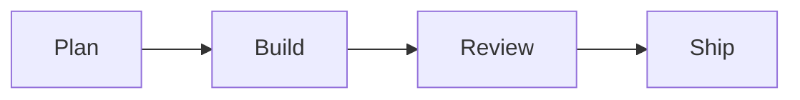

# sc-mods

Claude Code mods from SimpleClaude. A mod is a plugin that changes Claude Code's own interface; see the [mods documentation](https://code.claude.com/docs/en/plugins/mods/overview).

sc-mods does these things:

- It draws the mermaid diagrams in Claude's replies as Unicode text, so you can read a diagram in the terminal without copying it into a renderer.
- It puts `◀` and `▶` buttons in the band above the prompt, which scroll the conversation to your previous or next prompt.
- It moves Claude's shell commands out of the conversation into a drawer above the prompt, where each command opens to show its output.
- It draws a dashed `Turn N` line above each of your prompts after the first.
- It puts a `⧉ copy` button under Claude's replies, which copies the reply's markdown.
- It gives Claude a `show_image` tool, which shows you pictures inline in the conversation.

## Mermaid diagrams

When a reply contains a closed mermaid code block, the mod runs [merman](https://github.com/Latias94/merman) on the diagram and shows the drawing in place of the source. Nothing else in the reply changes, and the conversation the model sees still holds the mermaid source.

Before:

````markdown

````

After:

```text
┌──────┐   ┌───────┐   ┌────────┐   ┌──────┐
│      │   │       │   │        │   │      │
│ Plan ├──►│ Build ├──►│ Review ├──►│ Ship │
│      │   │       │   │        │   │      │
└──────┘   └───────┘   └────────┘   └──────┘
```

A mermaid code block is one whose fence is three or more backticks or tildes and whose language, the first word after the fence, is `mermaid` in any case. It closes on the same fence character repeated at least as many times. A block indented inside a list item or a `>` blockquote is drawn there, with the drawing kept inside the item or quote. A mermaid block inside another code block, such as a ` ````markdown ` example, or inside an HTML comment, is left as it is.

The drawing has to fit the terminal's width. For a flowchart that is too wide, the mod tries a compact layout, then wraps long node labels, then turns a left-to-right chart top-to-bottom. A sequence diagram gets a second, automatic layout. If no layout fits, or merman cannot read the diagram, the source stays as it was.

## Jump between prompts

The band above the prompt shows two buttons, `◀` and `▶`, with a dim count between them: `[ ◀ ] Turn 2/5 [ ▶ ]` while the arrows are on the second of five prompts. While the [tool drawer](#tool-drawer) is shown, the arrows sit in it, around its `Turn 2/5` button, and take no row of their own. The arrows start at the same column in every place, two cells in, so they do not move as you page through prompts. Click a button to scroll the conversation so your previous or next prompt sits at the top of the view, with Claude's reply to it below. The last prompts cannot reach the top when little follows them, so the view stops at the end of the conversation. The end of the conversation is a place after the newest prompt: `▶` on the newest prompt scrolls to the end, `▶` at the end scrolls there again, and `◀` at the end, where the count shows the newest prompt, goes to the prompt before it. To see the newest prompt at the top of the view, press `◀` then `▶`. The hotkeys `1` and `2` press the buttons while the band holds the keyboard: press ctrl+x then tab to move the keyboard to the band, or click in it; Esc returns it to the prompt box.

The arrows count every prompt you send while the mod runs. When the mod loads into a conversation that already has prompts (`claude --resume`, `claude --continue`, a plugin reload), it counts that conversation's prompts from its last compaction on. The arrows step from the place they last jumped to; each new prompt you send puts them back at the end, where the count shows the newest prompt. Scrolling the conversation yourself does not move them. On the newest prompt of a conversation the mod loaded into, `▶` scrolls to the last rows the transcript file holds. A toast says so when there is no earlier prompt, or no later prompt and no row to scroll to, and gives Claude Code's reason when it does not scroll.

Jumping needs fullscreen mode, where Claude Code draws the conversation itself. The classic layout leaves the conversation to the terminal's scrollback and refuses the scroll.

## Tool drawer

Claude's shell commands (the Bash tool) do not show in the conversation. They show in a drawer in the band above the prompt. The prompt arrows sit in the drawer's bottom border:

```text
╭─────────────────────────────────────────────────────────────────────────────────╮
│ ▾ Tool Usage (2 done · 1 failed · 1 running · bash) ● just test 3s              │
│ ▸ ✓ 󰯠  0.4s  git status                                                         │
│ ▾ ✗ 󰯠  1.2s  ls missing ⧉ copy                                                  │
│ ┃ $ ls missing                                                                  │
│ ┃ ls: missing: No such file or directory                                        │
│ ▸ … 󰯠  3s    just test                                                          │
╰─[ ◀ ]─[ Turn 3/8 ]─[ ▶ ]─────────────────────────────────────────────────────────╯
```

Closed, the drawer is one line, with the arrows first:

```text
  [ ◀ ] [ Turn 3/8 ] [ ▶ ] ▸ Tool Usage (2 done · 1 failed · 1 running · bash)
```

- Click the `Tool Usage` line to open or close the drawer. While a command runs, a `●` follows the counts, with the newest running command and its seconds so far, and the open drawer's border takes the running colour.
- The drawer lists the commands of the prompt the arrows are on. Press `◀` or `▶` to see another prompt's commands. Click `Turn 3/8`, between the arrows, to list the commands of every prompt (`All`), and click it again to go back.
- Each command has one line: a mark, a wrench icon (`󰯠`, U+F0BE0, which needs a Nerd Font), how long it took, and its first line, cut to one row with `…`. The times take the same width on every line, so the commands start at one column. The command is coloured by what each word does: command names, operators such as `&&` and `|`, flags, quoted strings, variables, redirects, paths and comments each take their own theme colour. Under the pointer the whole line lights as one block, in one colour. The marks are `✓` done, `✗` failed (in the error colour), `⊘` declined (refused before it ran, at the permission dialog or by a hook), `■` stopped with Esc, `↗` moved to the background (ctrl+b, a command started in the background, or one that passed its timeout), and `…` still running, with its seconds so far. The counts on the bar name each kind: `1 failed · 1 declined · 1 interrupted · 1 in background`. A command in the background shows no time, does not open by itself, and its open line says its task id: it runs on, and its output arrives in the conversation, not in the drawer.
- Click a command's line to show the full command and its output: stdout, then stderr, or the error. The open command shows the whole command after a `$`, highlighted by Claude Code's code highlighter, with its line breaks kept and long lines wrapped, up to 8 rows and then a dim `… N more lines` note. A green `┃` bar runs down its left side; a click on the bar closes the command, the same as a click on its line, and a click on the text beside it does nothing. The output is highlighted when its language is known: a diff from `git diff`, `git show`, `git log -p` or `diff -u`, JSON (output that parses as JSON, or a command ending in `| jq`), or the one file `cat`, `bat`, `head`, `tail` or `sed -n` printed, by its file name. Other output is plain, and a failed command's error is in the error colour. Each output line takes one row, cut at the drawer's edge. A long output shows its last 30 lines, fewer when the band has less room, under a dim `… N earlier lines` note. `⧉ copy` on an open command's line copies the command and its output.
- A command that fails stays closed, with its `✗` mark in the error colour; click its line to read the error.
- The drawer fits the band with any other mod's rows in it: when its commands do not fit, it shows the newest under a dim `… N earlier calls` line. An open command keeps its output in view before older closed commands do: they move into the `… N earlier calls` count first, and of several open commands the one opened last comes first. An open command with no room for its output shows closed. When the band has no room for even one command, the bar says `no room for cards`.
- The drawer opens by itself at the first command of each new prompt, until you open or close it yourself. After that it stays as you left it for the rest of the session.
- While the arrows are on the newest prompt, at the end of the conversation or jumped to, and it has no commands yet, the drawer keeps listing the latest earlier prompt's commands, at the same size and open or closed, until the newest prompt's first command starts. The count between the arrows shows the newest prompt, and the `Tool Usage` line names the turn the commands belong to: `Tool Usage (9 done · bash · turn 3)`.
- When the arrows are on a prompt with no commands, the drawer stays: closed, its line reads `Tool Usage (no commands · bash)`; open, it says `No commands in this turn`.
- When the conversation has no commands at all, or `/tool-drawer off` is set, the drawer is not shown, and the arrows take their own row.

Output shows as the terminal would leave it: colour codes and other escape sequences are removed, a line a progress bar rewrote with carriage returns keeps what was last written, tabs are expanded, and lines are cut to the band's width counting wide characters as two columns.

The command `/tool-drawer off` puts the shell commands back in the conversation and hides the drawer. `/tool-drawer on` turns it on again; it is on by default. `/tool-drawer` alone says whether it is on. The choice is kept for later sessions.

Only the main conversation's commands go to the drawer; a subagent's stay where they are. The drawer shows a command's output once the command ends, not while it runs. When the mod loads into a conversation that already ran commands (`claude --resume`, `claude --continue`, a plugin reload), the finished ones join the drawer under their prompts, with their output and how they ended but without how long they took, and leave the conversation; the drawer stays closed for them. `/clear` and `/resume` empty the drawer.

## Turn lines

Above each of your prompts after the first, a dim dashed line names the prompt's turn number, so the turns of a long conversation stand apart:

```text
╌╌╌╌╌╌╌╌╌╌╌╌╌╌╌╌╌╌╌╌╌╌╌╌╌╌╌╌╌╌╌╌╌╌╌╌ Turn 3 ╌╌
```

The number is the prompt's place in the count the arrows use. Notifications and messages from other sessions get no line. `/tool-drawer off` does not hide these lines.

## Copy a reply

A dim `⧉ copy` button sits under each block of Claude's reply text. Click it to put that block's markdown on the clipboard, as Claude wrote it: a mermaid diagram is copied as its source, not as the drawing. A toast says how many characters were copied, or why nothing was. A reply split by tool calls has a button under each block of text.

The button takes a mouse click only. The conversation's rows can't take keyboard focus, so no key presses it.

## Show pictures

Claude calls the `show_image` tool (`mcp__sc-mods__show_image`) to show you a picture file: a screenshot, a chart, a design, a generated image. The pictures are drawn in the tool's result row, in the conversation. The tool takes:

| Argument | What it is |
|---|---|
| `paths` | Picture files on this machine, as absolute paths. Required. A relative path is read from the folder the session started in, and a `file://` URL is read as its path. |
| `caption` | Optional. One line shown above the pictures. |
| `size` | `small`, `medium` (the default) or `large`. |

The tool shows local files only and makes no network request. An `http://` or `https://` URL fails with a message that tells Claude to save the picture to a file with its own tools first, for example with `curl` in Bash, and then pass the saved path.

Before it reads a file, the tool asks Claude Code's permission rules whether Claude may `Read` that path. A file the rules allow is shown. A file the rules deny fails with the rule's reason. For files the rules would ask about, you get one question for the whole call. In a `-p` run nobody can answer, so those files fail.

Any format macOS `sips` reads works: PNG, JPEG, GIF, HEIC, TIFF, WebP and more. The tool makes a PNG of each picture that fits the 2 MiB a terminal picture can hold: a PNG that already fits is copied, and any other picture is converted, scaled down to 1600 pixels on its longest side or less until it fits. It keeps the PNGs, with a record of the call, in `${XDG_CACHE_HOME:-~/.cache}/sc-mods/images/`, named by the call's id, so the row draws the pictures again when you resume the conversation. Files there older than 30 days are deleted when a session starts.

Each picture keeps its shape inside the size's box: 40% of the conversation's width and at most 12 rows for `small`, 70% and 24 rows for `medium`, and the full width and 40 rows for `large`. A small icon is enlarged at most about fourfold. The caption, if any, is above the pictures. Under each picture is its label line: a dim number when the row has more than one picture, the file's name as a link with ` ↗` (Cmd-click opens the file), then that picture's own `Hide` button and size button. `Hide` removes the picture and keeps its label line, with a `Show` button in its place. The size button shows the picture's size and steps it through small, medium and large; each picture starts at the size Claude asked for. The row remembers each picture's buttons for the rest of the session. A picture that cannot be shown has a red line with its reason in its place, and no buttons.

Claude reads one line, such as `Showed 2 pictures inline: before.png, after.png.`, and never the pixels: to look at a picture itself, Claude reads the file. That line also gives the reason for each picture that could not be shown. When no picture can be shown, the call is an error.

## Install

```bash
claude plugin install sc-mods --marketplace kylesnowschwartz/SimpleClaude
```

The plugin holds no merman binary. The first time a diagram needs drawing, `bin/merman-cli` downloads the merman release archive for your machine from [merman's GitHub releases](https://github.com/Latias94/merman/releases), checks it against the sha256 pinned in [`bin/merman.pin`](bin/merman.pin), and keeps the binary and merman's licenses in `${XDG_CACHE_HOME:-~/.cache}/sc-mods/merman-<version>/`. Later sessions run the cached binary, so the network is needed once per merman version. A plugin update that pins a new version downloads it and removes the old one from the cache.

merman-cli runs on macOS and on Linux with glibc, on arm64 and x86_64. The download needs `curl` and `shasum` or `sha256sum`, and on Linux also `xz`.

**A mod runs with your permissions.** It runs inside Claude Code and can start programs as you. This one starts merman-cli to draw diagrams, and `find` and `grep` to read the session's own transcript file (`<session id>.jsonl` under `~/.claude/projects/`, or `$CLAUDE_CONFIG_DIR/projects/`). For `show_image` it starts `sips`, `cp` and `mkdir` to make the PNGs, and `find` to delete the old ones; it reads only the files Claude Code's permission rules or you allow. Its only network call is the merman download above, and it writes files only in `${XDG_CACHE_HOME:-~/.cache}/sc-mods/`. The copy button writes to the clipboard through Claude Code, the way `/copy` does. Read [`hooks/register.ts`](hooks/register.ts), [`hooks/show-image.tsx`](hooks/show-image.tsx) and [`bin/merman-cli`](bin/merman-cli) before you install it.

## Settings

| Setting | What it does |
|---|---|
| `MERMAN_PATH` | Absolute path to a merman-cli to run instead of the downloaded one. With it set, nothing is downloaded. Set it at install with `--config MERMAN_PATH=/path/to/merman-cli`, or later with `/plugin configure`. |

If merman-cli cannot run, every diagram stays as source and Claude Code shows one notice with the reason, such as a failed download or a missing `curl`.

## Development

Load the plugin from the checkout, either for one session:

```bash
claude --plugin-dir plugins/sc-mods
```

or as an installed plugin that reads straight from your checkout:

```bash
claude plugin marketplace add /path/to/SimpleClaude
claude plugin install sc-mods@simpleclaude
```

Then edit the files and run `/reload-plugins`.

Check and test the mod:

```bash
just test-mods
```

These tests stand in for merman-cli, so they need no binary. `just test` includes the launcher's tests, which download from local archives rather than the network. To draw a flowchart, a sequence diagram and an invalid diagram with the real merman-cli, install [bun](https://bun.sh), then run:

```bash
just test-mods-real
```

It downloads merman-cli into the cache if it is not there, and stops with the launcher's reason if merman-cli cannot run on your machine.

### Upgrade merman

`just check-merman` reports whether a newer merman release is out. To move to it:

1. `just update-merman <version>` writes the version and the published checksum of each platform's archive to `bin/merman.pin`.
2. `just test-mods` and `just test-mods-real`.
3. Check a few diagrams live in `claude --plugin-dir plugins/sc-mods`.
4. Commit, then release with `just bump` and `just release`.

## Limitations

- A mermaid block without a closing fence shows its source.
- Some merman drawings have layout quirks: a flowchart edge that loops back runs against the boxes ([#183](https://github.com/Latias94/merman/issues/183)), a state diagram can print two transition labels run together ([#184](https://github.com/Latias94/merman/issues/184)), a long sequence message label can run past the next lifeline ([#185](https://github.com/Latias94/merman/issues/185)), and in a narrow terminal two side-by-side subgraphs can share a border ([#186](https://github.com/Latias94/merman/issues/186)).
- When the mod loads into a session that already has prompts (`claude --resume`, `claude --continue`, a plugin reload), it runs `find` and `grep` once over the session's transcript file to learn them and the conversation's last rows, on load or at the first press. Without those commands on the `PATH`, those prompts are not counted, and `▶` on the newest prompt has no end to scroll to until a new row is stored. Prompts from before the conversation's last compaction are not counted: Claude Code draws a resumed conversation from that point, so there is nothing to scroll to.
- After a rewind (Esc Esc, or editing an earlier prompt), the prompts the rewind went back past stay counted until `/clear` or `/resume`.
- The jump buttons step through the main conversation, and are hidden while an agent's transcript is on screen.
- The drawer keeps the last 200 commands of a session, and each command's last 200 output lines, each up to 400 columns. Past commands read back from a resumed conversation come from its newest 4096 messages.
- The mod is built for the terminal. The desktop app and the VS Code extension are untested.
- `show_image` reads and converts pictures with `sips`, which only macOS has. Where `sips` does not run, the tool is not registered, and Claude does not see it.
- Only the terminal draws `show_image` pictures, and only a terminal that can draw pixels. Elsewhere the row lists the caption and the paths as text.
- merman publishes merman-cli for macOS and glibc Linux only. On other systems, musl Linux such as Alpine included, the diagrams stay as source unless `MERMAN_PATH` points at a merman-cli.
- The first diagram after a new merman version waits for the download. If the download takes longer than 15 seconds, that reply keeps its source and the next diagram tries again.
